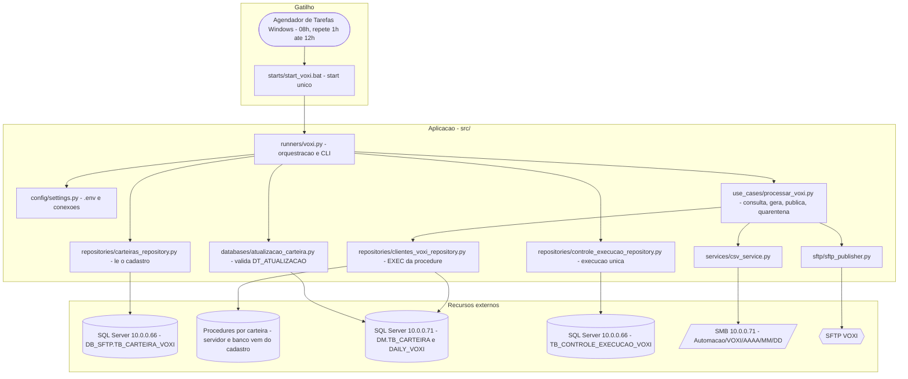
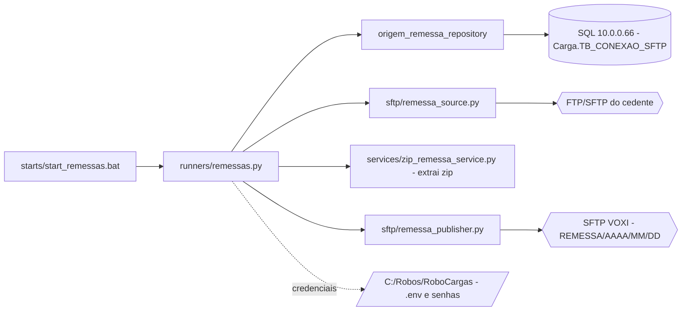
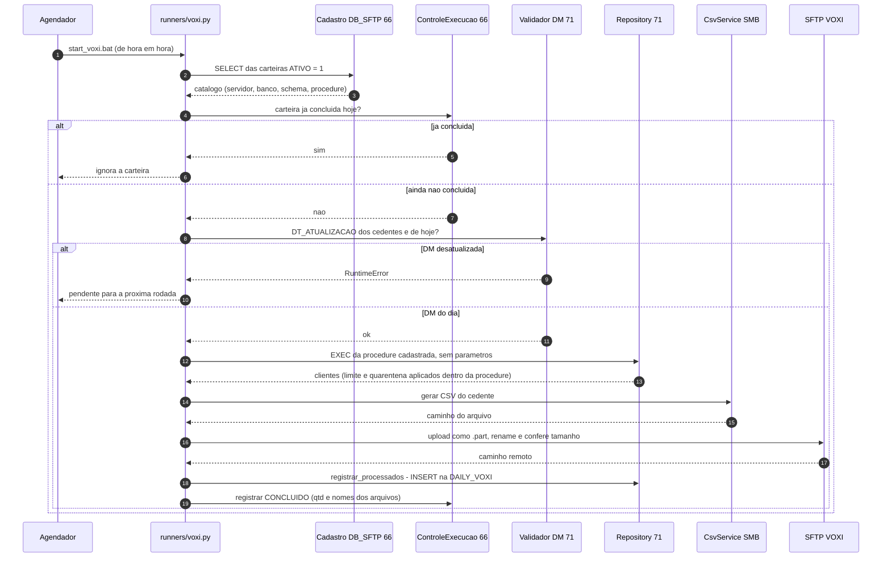

# 01 — Arquitetura e Diagrama

> **Fase 1 do fluxo.** Documento produzido a partir do código já existente, para colocar o
> projeto no Padrão Grupo Acme. Reflete o comportamento real do robô em agosto de 2026.

---

## 1. Visão em uma frase

Robô que seleciona diariamente os clientes elegíveis de cada carteira de cobrança, gera um
arquivo CSV por cedente e publica esses arquivos no SFTP da VOXI (discadora), garantindo
quarentena, execução única por dia e rastreabilidade.

O repositório contém **dois fluxos independentes**:

| Fluxo | Entrada | O que faz | Saída |
|---|---|---|---|
| **Envio Ativo** (principal) | `DB_REPORT` (SQL Server `.71`) | Consulta clientes elegíveis, gera CSV e publica | SFTP VOXI, `ENVIOS_ATIVOS/AAAA/MM/DD` |
| **Envio de Remessas** | FTP/SFTP dos cedentes | Copia a remessa recebida do cedente e republica | SFTP VOXI, `REMESSA/AAAA/MM/DD` |

---

## 2. Diagrama de estrutura (componentes)



> **Configuração fora do código.** O catálogo de carteiras não existe mais em Python. Incluir,
> remover ou desativar uma carteira é `INSERT`/`UPDATE` em `DB_SFTP.dbo.TB_CARTEIRA_VOXI`;
> mudar a régua de uma carteira é `ALTER PROCEDURE`. Nenhum dos dois exige deploy.

> **Start único.** Não há mais um `.bat` por carteira. `starts/start_voxi.bat` (sem argumento)
> roda **todas** as carteiras ativas numa rodada; para reprocessar uma carteira isolada, use
> `start_voxi.bat <id_cedente ou nome>` (equivale a `python -m scripts.executar_voxi --carteira <id_cedente ou nome>`). O único outro `.bat` é
> `start_remessas.bat`, do fluxo secundário. Como a carteira a processar vem do cadastro,
> incluir uma nova **não** exige criar `.bat` nem módulo Python.

### Fluxo secundário — Envio de Remessas



---

## 3. Diagrama de fluxo (processo principal)

Passo a passo de **uma carteira** dentro de uma rodada do Envio Ativo.



**Regra de ouro do fluxo:** a quarentena (`DAILY_VOXI`) e o controle de conclusão só são
gravados **depois** do upload confirmado. Se o SFTP falhar, o cliente não é quarentenado e
volta a ser elegível na próxima rodada.

---

## 4. Fluxo de dados

**Cadastro.** `DB_SFTP.dbo.TB_CARTEIRA_VOXI` no SQL Server `10.0.0.66`. É a primeira coisa
lida em toda execução, e devolve, para cada carteira ativa: `CEDENTE` (a identidade — nome do
arquivo, normalizado em maiúsculo), `ID_CEDENTE` (o cedente/SFTP que valida a carga; **pode
repetir** entre carteiras do mesmo grupo — ex.: Mu, Xiclub e Eta são o cedente 3),
`VALIDA_CARGA` (`0` = não confere a carga na DM para essa carteira — ZETA e PI) e o endereço
da procedure (`SERVIDOR`, `BANCO`, `SCHEMA_PROC`, `NOME_PROC`). DDL e carga inicial em
[`sql/estrutura/TB_CARTEIRA_VOXI.sql`](../sql/estrutura/TB_CARTEIRA_VOXI.sql).

**Origem dos clientes.** Uma stored procedure por carteira, no servidor e banco que o cadastro
indicar. A procedure é chamada **sem parâmetros** — limite, quarentena e regra de telefone
vivem dentro dela. O robô conecta com a credencial única do `.env` (`DB_USER`/`DB_PASSWORD`);
o cadastro guarda endereço, nunca segredo.

**Contrato da procedure.** Entre os result sets devolvidos, o robô procura o primeiro que
contenha todas estas colunas — o que permite `SELECT ... INTO #TEMP` intermediários sem
atrapalhar:

```
TELEFONE, CPF_CNPJ, NOME, CREDOR, ID_CLIENTE, ATRASO, SALDO_DEVEDOR
```

Se nenhum result set cumprir o contrato, a carteira falha com mensagem nomeando a procedure.

**Transformação.** As linhas viram `ClienteVoxi` (telefone, cpf_cnpj, nome, credor,
id_cliente, atraso, saldo_devedor). Só os 4 primeiros campos vão para o arquivo; os demais
existem para a gravação da quarentena.

**Saída — arquivo.** Um CSV por carteira, nomeado pelo `CEDENTE` do cadastro, em
`\\10.0.0.71\d\Automacao\VOXI\AAAA\MM\DD\<CEDENTE>_AAAAMMDD.csv`.
Formato: UTF-8 sem BOM, separador `;`, quebra de linha `\n`, com cabeçalho
`TELEFONE;CPF_CNPJ;NOME;CREDOR` (a coluna `CREDOR` do arquivo vem da procedure).

**Saída — SFTP.** `<SFTP_REMOTE_DIR>/ENVIOS_ATIVOS/AAAA/MM/DD/<mesmo nome>`. O envio usa
arquivo temporário `.part` seguido de `rename`, e valida o tamanho após o upload.

**Persistência de estado.**

| Onde | Servidor | Para quê |
|---|---|---|
| `DB_SFTP.dbo.TB_CARTEIRA_VOXI` | `.66` | Cadastro das carteiras e endereço das procedures |
| `DB_PLANEJAMENTO.dbo.DAILY_VOXI` | `.71` | Quarentena — impede reenviar o mesmo cliente por 4 ou 8 dias |
| `LOGS_ROBOS.dbo.TB_CONTROLE_EXECUCAO_VOXI` | `.66` | Execução única por dia, chaveada por `DATA_REF` + `ID_CEDENTE` + `CEDENTE` (id compartilhado não bloqueia as outras partes) |
| `logs/voxi_AAAAMMDD.log` | local | Diagnóstico; CPF e telefone aparecem mascarados |

A gravação da quarentena é feita **sempre** na `DAILY_VOXI` do `.71`, com conexão própria —
independente de onde a procedure da carteira roda.

**Volume.** Até 1000 clientes por carteira/cedente por dia, em 11 carteiras.

---

## 5. Decisões de arquitetura

| Ponto | Escolha | Alternativas descartadas | Motivo |
|---|---|---|---|
| Organização do código | Camadas `domain` / `application` / `infrastructure` / `runners` | Script único | Permite trocar SFTP ou banco sem tocar na regra de negócio; as interfaces em `domain/interfaces` tornam o fluxo testável sem infraestrutura real |
| Local das consultas | **Stored procedure**, uma por carteira, endereçada pelo cadastro | Arquivos `.sql` no repositório (modelo anterior); SQL embutido no Python | A régua mudou 3 vezes em 2 meses, e cada troca exigia alterar arquivo e fazer deploy. Com procedure, o time de dados publica `ALTER PROCEDURE` e o robô pega na próxima rodada |
| Parametrização das carteiras | **Tabela `DB_SFTP.dbo.TB_CARTEIRA_VOXI`** | Catálogo fixo em `settings.py` (modelo anterior); arquivo JSON | Incluir carteira exigia mexer em `settings.py`, criar `.sql`, criar módulo Python e criar `.bat`. Agora é uma linha na tabela |
| Parâmetros da procedure | **Nenhum** | Manter os 4 parâmetros (`@FILTRO_CARTEIRA`, `@CREDOR`, `@LIMITE`, `@DIAS_QUARENTENA`) | Decisão do responsável: limite e quarentena passam a viver dentro da procedure, junto do resto da régua, em um lugar só |
| Localização do result set | Procura o primeiro result set que cumpra o contrato de colunas | Assumir o primeiro result set, ou o último | Procedure costuma emitir result sets intermediários; assumir posição fixa quebraria silenciosamente, entregando o arquivo errado |
| Credenciais dos servidores | Uma credencial única do `.env` para todos | Credenciais por linha na tabela | Mantém o cadastro livre de segredo, como exige a seção 6 do `PROJETO.md` |
| Identificadores do cadastro | Validados por regex antes de entrar no `EXEC` | Confiar no conteúdo da tabela | O nome da procedure é interpolado na query; sem validação, quem escreve na tabela consegue injetar SQL |
| Acesso ao SQL Server | `pyodbc` | SQLAlchemy, pymssql | Padrão já usado no `C:\Robos\RoboCargas`; driver ODBC homologado nos servidores |
| Transferência | `paramiko` (SSH/SFTP) | `pysftp` (sem manutenção) | Biblioteca ativa e já padronizada na equipe |
| Integridade do upload | Envia como `.part`, faz `rename` e confere o tamanho | Upload direto | Impede a VOXI de ler um arquivo pela metade |
| Momento da quarentena | `INSERT` na `DAILY_VOXI` só após upload confirmado | `INSERT` dentro da própria query | Se o SFTP falhar, o cliente não é queimado e volta na próxima rodada |
| Execução única no dia | Tabela `TB_CONTROLE_EXECUCAO_VOXI` no `.66` | Arquivo de flag local | Permite agendar de hora em hora com segurança e consultar o status de fora do servidor |
| Trava de base velha | Valida `DT_ATUALIZACAO` da `DM.TB_CARTEIRA` antes de qualquer efeito | Confiar no horário do agendamento | A carga da DM atrasa com frequência; sem a trava o robô discaria base do dia anterior |
| Credenciais das remessas | Reaproveita `.env` e chaves de `C:\Robos\RoboCargas` | Duplicar as credenciais neste projeto | Evita a mesma senha de cedente cadastrada em dois lugares |

---

## 6. Riscos e pontos de atenção

| # | Risco | Impacto | Mitigação atual |
|---|---|---|---|
| R1 | O `.env` com `DB_PASSWORD` e `SFTP_PASSWORD` está versionado no repositório remoto | Alto — credenciais expostas | **Nenhuma.** Ressalva aceita pelo responsável; ver seção 7 do `PROJETO.md` |
| R2 | `paramiko>=4,<5` não estava com versão fixada | Médio — build não reprodutível | Corrigido na Fase 3 |
| R3 | `AutoAddPolicy` aceita qualquer host key do SFTP | Médio — vulnerável a MITM na primeira conexão | Rede interna / VPN |
| R4 | A carga da `DM.TB_CARTEIRA` pode não chegar até 12:00 | Médio — carteira fica sem envio no dia | Agendamento de hora em hora e log de pendência; flag `--ignorar-validacao-carga` para envio manual |
| R5 | Indisponibilidade do SMB `\\10.0.0.71` | Alto — nenhum arquivo é gerado | Erro tratado por carteira; as demais continuam |
| R6 | O fluxo de remessas depende de `C:\Robos\RoboCargas` existir na máquina | Alto — não roda fora do servidor | Caminho configurável por `ROBO_CARGAS_ROOT` |
| R7 | A régua de negócio (limite, quarentena, telefone) vive nas procedures, fora do alcance de teste unitário | Médio | Os testes cobrem o contrato de colunas; a régua é validada na homologação |
| R8 | Uma procedure que retorne 0 linhas não conclui a carteira | Baixo — comportamento intencional | Contabilizado como `sem_clientes` no resumo da rodada |
| R9 | O cadastro no `.66` virou ponto único de falha: sem ele, nenhuma carteira roda | Alto | Erro explícito no log já na primeira linha da execução. Mesmo servidor que já hospeda o controle diário, então não amplia a superfície de indisponibilidade |
| R10 | Quem tem escrita em `TB_CARTEIRA_VOXI` passa a controlar qual procedure o robô executa | Médio | Identificadores validados por regex; restringir permissão de escrita na tabela ao time responsável |
| R11 | Uma procedure com nome cadastrado errado só falha na hora do `EXEC` | Baixo | Falha isolada por carteira, com a origem completa (`servidor/banco.schema.proc`) na mensagem |

---

**Critério de pronto da Fase 1:** o diagrama cobre componentes, comunicação e fluxo de dados
de ponta a ponta. **Pendente de revisão com o responsável.**
